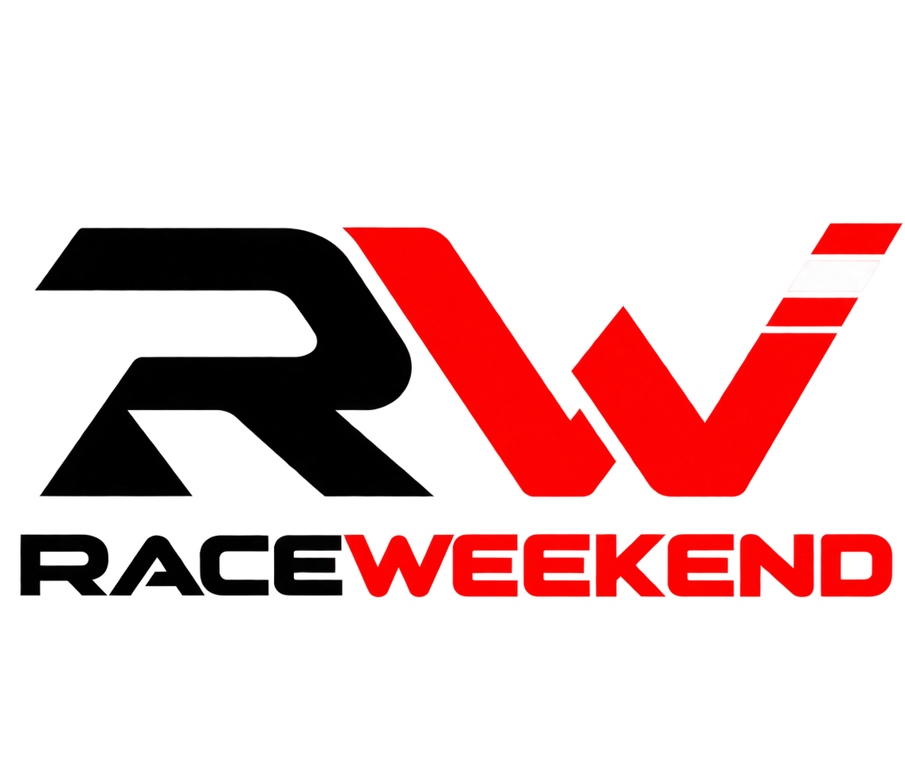

<p align="center">
  
</p>

<h1 align="center">Race Weekend</h1>

<p align="center">An unofficial, remote-friendly way to watch F1 TV on LG webOS.</p>

<p align="center">
  <a href="https://github.com/Ravboni/race-weekend/releases">Releases</a>
  ·
  <a href="docs/INSTALL.md">Installation guide</a>
  ·
  <a href="CONTRIBUTING.md">Contributing</a>
  ·
  <a href="docs/PR_HISTORY.md">PR history archive</a>
</p>

**Race Weekend is built to bring F1 TV to LG webOS televisions.** It lets you sign in with your own F1 TV account, browse F1 TV's catalogue, and watch the streams available to your subscription using the television's web runtime and media capabilities. It is a webOS app in its own right, not the Android TV app running through an emulator.

> **Unofficial and experimental.** This project is not affiliated with or endorsed by Formula 1, F1 TV, or Liberty Media. It requires an F1 TV account with the appropriate subscription. F1 may change its services, API, account flow, regional availability, or DRM requirements at any time.

## At a glance

| | |
| --- | --- |
| Latest release | [v0.16.27](https://github.com/Ravboni/race-weekend/releases/tag/v0.16.27) |
| Verified devices | LG C2, webOS 11.2.0; LG OLED55E9PLA, webOS 4.5 / firmware 05.50.00 |
| Install package | `.ipk` from GitHub Releases |
| TV setup | Rooted or Developer Mode |
| Subscription | Your own F1 TV subscription |

Both TVs have been checked end to end. On the OLED55E9PLA, the development build loaded the catalogue and artwork, completed F1 phone pairing, supported remote navigation, and played the full 2026 United States GP Practice 2 replay with picture and audio. Older webOS TVs use a conservative video bitrate cap for decoder compatibility. Other models and firmware versions may behave differently.

## Install on your TV

1. Download the latest `.ipk` from [Releases](https://github.com/Ravboni/race-weekend/releases/latest).
2. Install it using [webOS Dev Manager](https://github.com/webosbrew/dev-manager-desktop/releases/latest) or LG's webOS CLI.
3. Open **Race Weekend** on the TV and follow the on-screen phone-pairing steps for your F1 TV account.

The [installation guide](docs/INSTALL.md) explains rooted TV and Developer Mode setup, install and update steps, CLI commands, and uninstalling. New packages are published here after changes are promoted to `main`.

Public releases built after the provenance-enabled workflow reaches `main` include a GitHub Actions build attestation for the `.ipk`. GitHub currently limits artifact attestations to public repositories on Free, Pro, and Team plans; the workflow skips attestation while this repository is private. To verify a downloaded package with [GitHub CLI](https://cli.github.com/), run:

```sh
gh attestation verify ./path/to/downloaded-package.ipk --repo Ravboni/race-weekend
```

The attestation proves which repository workflow produced the package and binds that claim to its digest. It does not guarantee that the source code itself is free of defects.

## What it can do

- Browse F1 TV home, live events, archive, search results, and video details.
- Sign in using F1's official phone-pairing flow.
- Play entitled live sessions and replays when F1 provides a stream compatible with the TV.
- Choose a live feed independently from the language and subtitle options offered for that feed.
- Navigate with the TV remote, including playback controls and D-pad seeking.
- Show a TV-scale interface with large cards, Roboto typography, and clear focus states.

Feed names, audio languages, subtitles, and available replays vary by event, account, and region.

## Remote controls

- **Up / Down / Left / Right:** Move through the focused screen or control.
- **OK:** Select the focused item; confirm a seek position while the playback timeline is active.
- **Back:** Close the current player panel or overlay, then navigate back through the app.
- **During playback:** Open feed and audio/subtitle choices from their separate controls; use the timeline to seek.

Exact behavior can vary slightly between TV remotes and webOS versions.

## Playback and known limitations

The app requests streams allowed by the signed-in account and uses webOS playback and DRM support. It does not decrypt, record, or redistribute protected video.

- A stream may be unavailable because of subscription tier, region, event rights, or F1's response for that item.
- Replay DRM metadata is not consistent across every archive item. Some replays may not play on a particular TV even when the account can open their details.
- Playback compatibility depends on the TV model and webOS firmware. The LG C2 on webOS 11.2.0 and OLED55E9PLA on webOS 4.5 / firmware 05.50.00 have been checked end to end; other models may behave differently.
- Older webOS browsers use a capability-detected compatibility path for layout, JavaScript APIs, account pairing, and remote navigation. This path was verified on the OLED55E9PLA (Chromium 53).
- The legacy-browser playback path starts at about 2 Mbps and caps video at 2.5 Mbps. On the OLED55E9PLA, this selects a stable 540p rendition; the next 720p H.264 rung failed to decode. Newer TV profiles remain uncapped.
- Changes to F1's services may temporarily break sign-in, catalogue browsing, or playback.

## Build from source

Requirements: Node.js 20 or newer, npm, and the [webOS CLI](https://webostv.developer.lge.com/develop/tools/cli-installation).

```sh
npm install --global @webos-tools/cli
git clone https://github.com/Ravboni/race-weekend.git
cd race-weekend
git switch develop
npm ci --ignore-scripts
./scripts/package.sh
```

The package is created under `dist/`. To install it, register your TV with `ares-setup-device`, then run:

```sh
ares-install --device myTV ./dist/com.ravboni.raceweekend_*.ipk
ares-launch --device myTV com.ravboni.raceweekend
```

Contributions go to `develop` first. The project owner promotes reviewed changes to `main` and creates version tags; only commits already on `main` can produce a release. See [CONTRIBUTING.md](CONTRIBUTING.md) for the branch and release workflow.

## Account data and safe bug reports

The app encrypts its saved session token with AES-GCM in IndexedDB. The non-exportable WebCrypto key is stored in that same database, so this is protection against casual file access, not secure or hardware-backed storage. It does not protect against code running in the app's origin or someone with root access to the TV.

Logging out clears the session stored on the TV; it does not revoke the token at F1, which remains valid until it expires. If the TV is lost or sold, remove it from your F1 account: sign in on the F1 TV website, open **Manage Account → My Subscriptions → Devices**, then edit the device list and remove the TV. See [F1's device management instructions](https://f1help.formula1.com/article/Managing-your-F1-TV-account).

Pairing codes, account tokens, signed stream URLs, DRM challenges, and license responses must remain private. Never paste them into an issue, screenshot, log, or commit.

When reporting a problem, include the TV model, webOS version, app version, event or feed type, and the visible error message. See [the implementation notes](docs/official-player-notes.md) for non-secret observations about the sign-in, catalogue, and playback flows.

## Brand assets

The app uses the supplied Race Weekend RW wordmark throughout its branding. The mark is tightly cropped from the transparent original so it remains large and legible in small graphics. The square launcher tile is [`assets/brand/race-weekend-logo.png`](assets/brand/race-weekend-logo.png); the original cropped transparent artwork is [`assets/brand/race-weekend-logo-master.png`](assets/brand/race-weekend-logo-master.png). The webOS package uses 80×80 and 130×130 versions of this mark in `icon.png` and `largeIcon.png`.

The repository banner is [`assets/brand/race-weekend-social-preview.jpg`](assets/brand/race-weekend-social-preview.jpg) (1280×640). It places the exact supplied wordmark on a light panel for contrast against a dark racing-inspired background. The logo assets retain the source lettering and proportions; only the empty transparent margins are cropped for the app-sized files.

## Third-party software and project license

The project is licensed under the [MIT License](LICENSE). The app bundles dash.js and a QR-code generator; their license texts are in [`vendor/`](vendor/). Roboto's license is in [`assets/fonts/OFL.txt`](assets/fonts/OFL.txt). These bundled components retain their own licenses.

To report a security issue, follow [`SECURITY.md`](SECURITY.md). Do not post vulnerabilities or account data in public issues.

## References

- [F1 TV supported devices](https://f1help.formula1.com/article/Supported-devices)
- [LG webOS streaming and DRM support](https://webostv.developer.lge.com/develop/specifications/streaming-protocol-drm)
- [LG webOS DRM content playback](https://webostv.developer.lge.com/develop/guides/drm-content-playback)
- [LG webOS CLI installation and developer guide](https://webostv.developer.lge.com/develop/tools/cli-installation)
- [webOS Homebrew](https://www.webosbrew.org/)
